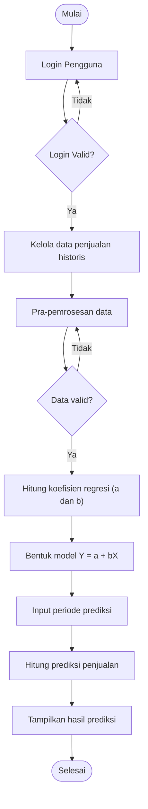

# Flowchart Sistem Usulan

Flowchart sistem prediksi penjualan produk percetakan berbasis website menggunakan algoritma regresi linier (Ide Segar Printing).

## Keterangan Alur

| No | Langkah | Penjelasan |
|----|---------|------------|
| 1 | Mulai | Proses dimulai saat pengguna mengakses sistem. |
| 2 | Login Pengguna | Pengguna memasukkan data akun untuk masuk ke sistem. |
| 3 | Login Valid? | Jika valid, lanjut ke pengelolaan data. Jika tidak, pengguna kembali ke login. |
| 4 | Kelola data penjualan historis | Pengguna menambah, mengubah, menghapus, atau mengimpor data penjualan. |
| 5 | Pra-pemrosesan data | Sistem menyiapkan data, misalnya memeriksa data kosong atau duplikat dan mengurutkan periode. |
| 6 | Data valid? | Jika valid, lanjut ke perhitungan. Jika tidak, kembali ke pra-pemrosesan data. |
| 7 | Hitung koefisien regresi (a dan b) | Sistem menghitung konstanta (a) dan koefisien kemiringan (b) dari data historis. |
| 8 | Bentuk model Y = a + bX | Sistem menyusun persamaan regresi linier. |
| 9 | Input periode prediksi | Pengguna menentukan periode yang akan diprediksi. |
| 10 | Hitung prediksi penjualan | Sistem menghitung nilai prediksi dengan persamaan regresi. |
| 11 | Tampilkan hasil prediksi | Hasil prediksi ditampilkan pada antarmuka website. |
| 12 | Selesai | Proses berakhir. |
